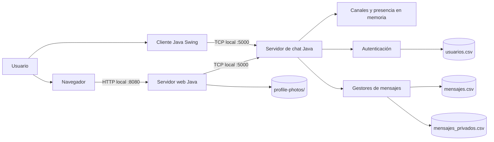

# Echo

Echo es una aplicación de mensajería en tiempo real desarrollada en Java. Permite conversar en canales y por mensajes privados mediante una interfaz web adaptable o un cliente de escritorio Java Swing. El servidor y los clientes se comunican mediante sesiones TCP.

> Echo escucha solo en `127.0.0.1` y está pensado para ejecutarse en un mismo equipo. No es un servicio de chat público ni está preparado para exponerlo directamente a Internet.

## Funcionalidades

- Registro, inicio de sesión y cambio de contraseña.
- Canales: General, Fútbol, Inteligencia Artificial, Noticias, Actualidad y Tecnología.
- Directorio de usuarios con búsqueda e indicador de presencia.
- Mensajes privados, incluidos mensajes pendientes para usuarios desconectados. El servidor los conserva hasta confirmar la entrega.
- Historial de mensajes de canal guardado localmente.
- Perfiles con imagen PNG o JPEG. Las imágenes se limitan a 4 MB y se guardan como miniaturas cuadradas de 512 × 512 píxeles.
- Interfaz web adaptable y cliente de escritorio Java Swing.

## Tecnologías

- Java (JDK 8 o posterior).
- Sockets TCP para las sesiones y el transporte de mensajes.
- Servidor HTTP integrado de Java para servir la web y sus rutas locales.
- HTML5, CSS3 y JavaScript sin frameworks ni recursos externos.
- CSV para almacenar cuentas, historial de canales y mensajes privados pendientes.
- JUnit 5 para las pruebas existentes.

No se necesita Maven ni Gradle para compilar la aplicación. El JAR de JUnit incluido se usa únicamente para ejecutar las pruebas.

## Arquitectura



El servidor TCP atiende las conexiones de clientes en hilos separados. Para la web, el servidor HTTP mantiene una sesión TCP con el servidor de chat y expone rutas locales para las acciones y los eventos del navegador. Los canales y la presencia viven en memoria; las cuentas y los mensajes se guardan en archivos locales relativos al directorio de ejecución.

## Contraseñas y datos

Echo no incluye cuentas ni contraseñas predeterminadas. Cada usuario crea su contraseña al registrarse; debe tener al menos 12 caracteres. Las contraseñas se almacenan como hashes PBKDF2-HMAC-SHA256 con sal aleatoria, no en texto plano. Las cuentas heredadas se migran al iniciar el servidor y deben cambiar la contraseña en su siguiente acceso.

Los CSV, los logs y las fotos de perfil son datos locales. No subas datos reales de usuarios al repositorio. Las rutas de datos de `Echo/` están excluidas en el `.gitignore` de la raíz del repositorio.

## Requisitos

- JDK 8 o posterior, con `javac` y `java` disponibles en PATH.
- Windows, macOS o Linux.
- Navegador moderno para usar la interfaz web.

## Compilar y ejecutar la aplicación web

Abre PowerShell en esta carpeta, donde están `README.md`, `web/` y `Echo/`. Compila las clases de producción en una carpeta temporal:

```powershell
$clases = Join-Path $env:TEMP 'echo-classes'
New-Item -ItemType Directory -Force $clases | Out-Null
$fuentes = Get-ChildItem .\Echo -Recurse -Filter *.java |
    Where-Object { $_.FullName -notmatch '[\\/]Pruebas[\\/]' }
javac -encoding UTF-8 -d $clases $fuentes.FullName
```

Inicia el servidor:

```powershell
java -cp $clases Servidor.ServidorChat
```

Abre <http://127.0.0.1:8080> y crea una cuenta. Mantén abierta la terminal mientras uses Echo; pulsa `Ctrl+C` para detener el servidor. Los archivos CSV y las fotos se crearán localmente en el directorio de trabajo desde el que inicies el proceso.

## Ejecutar el cliente de escritorio

Con las clases compiladas y el servidor en ejecución, abre otra terminal en esta carpeta y ejecuta:

```powershell
java -cp $clases Cliente.VentanaChat
```

## Ejecutar las pruebas existentes

Las pruebas leen y escriben CSV relativos al directorio actual. Ejecútalas desde una carpeta temporal para no alterar los datos de la aplicación:

```powershell
$raiz = (Get-Location).Path
$temporal = Join-Path $env:TEMP ('echo-tests-' + [Guid]::NewGuid().ToString('N'))
$clasesPrueba = Join-Path $temporal 'classes'
New-Item -ItemType Directory -Path $clasesPrueba | Out-Null
$fuentes = Get-ChildItem .\Echo -Recurse -Filter *.java
$junit = Join-Path $raiz 'lib\junit-platform-console-standalone-1.13.0-M3.jar'
javac -encoding UTF-8 -cp $junit -d $clasesPrueba $fuentes.FullName
Push-Location $temporal
try {
    java -jar $junit execute --class-path $clasesPrueba --scan-class-path --details summary
} finally {
    Pop-Location
}
```

## Limitaciones

- Los servicios web y TCP solo escuchan en loopback (`127.0.0.1`). No se ofrece TLS para acceso remoto.
- La persistencia se basa en archivos CSV locales, no en una base de datos multiusuario.
- Los canales y la presencia se mantienen en memoria y se reinician al apagar el servidor.

## Licencia

Este repositorio no especifica todavía una licencia. Añade un archivo `LICENSE` si quieres definir los permisos de uso, modificación y distribución.
